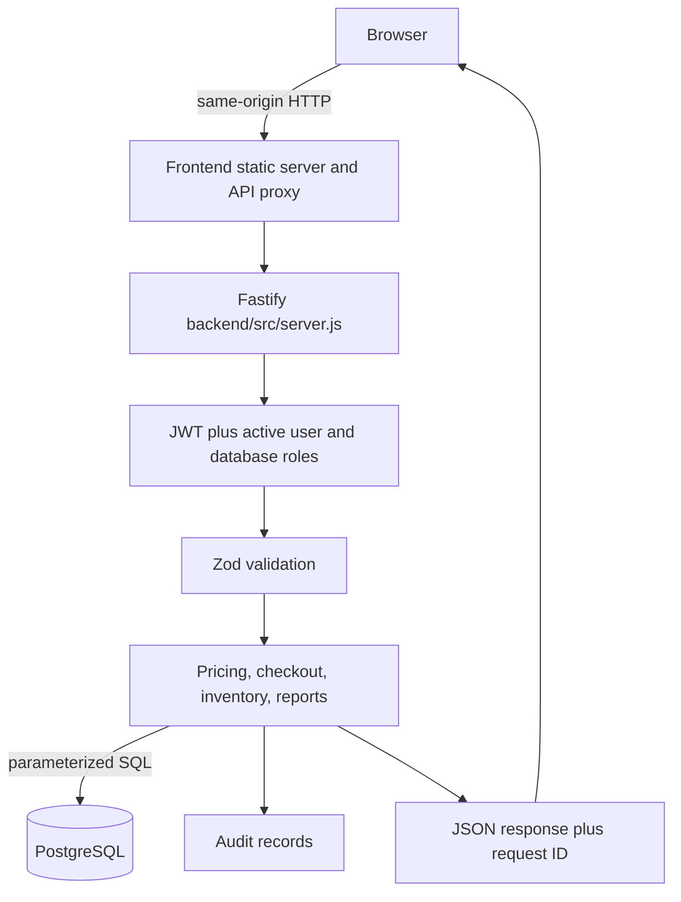
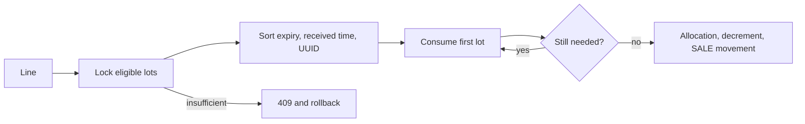
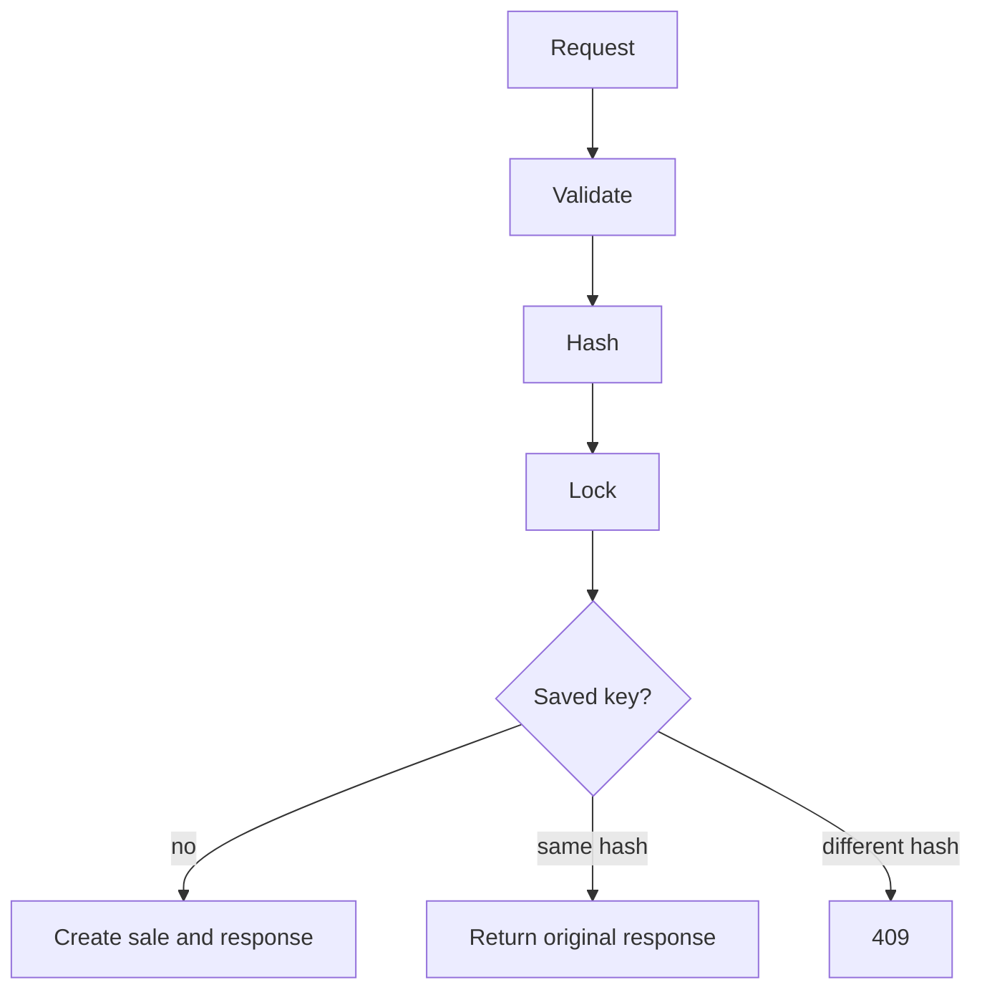
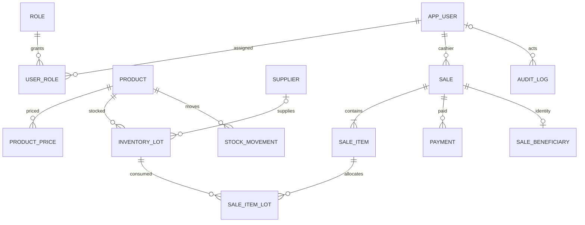

# Clinic POS — Developer Manual

## System Architecture, Codebase Guide, Database Reference, and Maintenance Manual

Version 1.0 · 28 September 2026 · Repository: D:\pos\clinic-pos  
Audience: developers inheriting, operating, or changing this codebase.

This manual describes the source inspected on the date above. Current source and migrations are authoritative. The existing architecture/API notes are older and partly stale. Tax and invoice fields are application configuration; their presence does not establish legal, accounting, or regulatory compliance.

## Contents
1 Overview · 2 Architecture/request flow · 3 Repository map · 4 Setup · 5 Authentication/roles · 6 Products/inventory · 7 Checkout · 8 Pricing/tax/discount · 9 Tender/change · 10 Idempotency · 11 Invoices/privacy · 12 Database/migrations · 13 API · 14 Frontend/POS · 15 Reports/audit · 16 Tests · 17 Security · 18 Troubleshooting · 19 Maintenance · 20 Limitations · 21 Quick reference

## 1. Overview
Clinic POS is a local web point-of-sale application for a clinic selling physical products and services. Cashiers authenticate, search an active catalog, build a cart, request a server quote, tender payment, and complete a sale. Admins manage users, catalog/prices, suppliers, stock lots, tax settings, reports and audit records. PostgreSQL is the durable store.

Prices and tax/discount inputs are selected/calculated server-side. Completed sale lines and tax/discount inputs are snapshotted; later catalog edits do not rewrite historical transactions. Physical products consume inventory; services do not. Sale, stock, tender, audit and idempotency writes share a PostgreSQL transaction. There is no external payment processor integration: CAPTURED means recorded by this application, not confirmed by a payment network. The software does not electronically verify SC/PWD eligibility or prove BIR compliance.

## 2. Architecture and request flow


Frontend binds to 127.0.0.1:4173 and proxies /api to 127.0.0.1:3000 by default (API_PORT). API uses HOST/PORT and defaults to loopback:3000. A protected handler verifies Bearer JWT, reloads active user/current roles from PostgreSQL, validates route input with Zod, executes parameterized SQL and returns JSON. Fastify maps validation failures to 400 INVALID_INPUT; errors carry code, message and request_id, also returned in x-request-id. Unexpected errors are logged and masked.

```mermaid
sequenceDiagram
 Browser->>API: POST /sales + Idempotency-Key
 API->>DB: BEGIN; advisory lock by cashier/key
 DB-->>API: replay or proceed
 API->>API: server price, tax, discount, tender
 API->>DB: stable product locks then FEFO lot locks
 API->>DB: sale snapshots, allocations, stock movements, payment
 API->>DB: audit and replay response; COMMIT
 API-->>Browser: sale response
```

The tx helper commits callback success, rolls back errors and always releases its client. Checkout side effects belong inside this transaction.

## 3. Repository map
| Path | Responsibility |
|---|---|
| backend/src/server.js | Fastify routes, authentication, authorization, checkout, reports and SQL; most business behavior is here. |
| backend/src/pricing.js | Cent conversion and sale arithmetic. |
| backend/src/sales-input.js | Strict checkout schema and tender rules. |
| backend/src/canonical-json.js | Recursive stable request serialization. |
| backend/src/product-response.js | Role-dependent product data. |
| backend/src/security-config.js | Access-token secret check. |
| backend/src/admin-credentials.js, bootstrap-admin.js | First Admin validation/hash/account setup. |
| backend/src/migrate.js | Ordered SQL migration runner/checksum ledger. |
| backend/migrations | Five PostgreSQL schema migrations. |
| backend/tests | Node test runner unit/source tests and optional DB integration tests. |
| frontend/index.html, app.js | Browser entry, state, rendering and event handling. |
| frontend/checkout.js, api-client.js, pos-ux.js | Checkout, token refresh/API rules, scanner and expiry UX. |
| frontend/server.js | Static server and backend proxy. |
| frontend/styles.css, icons.svg | Styles and local icon sprite. |
| docs/CLINIC_POS_DEVELOPER_MANUAL.md | Source edition of this manual. |

The existing docs/architecture.md is an earlier proposal. docs/api-contract.md is partial/stale; it says change is not calculated, while current code accepts a single cash over-tender. Current implementation wins.

## 4. Setup and startup
Requires Node.js 20+ and PostgreSQL. Copy backend/.env.example to an untracked backend/.env. Set DATABASE_URL and unique ACCESS_TOKEN_SECRET, at least 32 bytes and not a placeholder. DATABASE_SSL=true enables verified TLS. Optional HOST/PORT, FRONTEND_PORT (4173), API_PORT (3000). Never put credentials in source/docs/logs.

```powershell
cd D:\pos\clinic-pos\backend
npm install
npm run migrate
npm run bootstrap:admin
npm start
```

Bootstrap refuses if an active Admin exists. Interactive mode prompts; unattended needs ADMIN_USERNAME, ADMIN_DISPLAY_NAME, ADMIN_PASSWORD. Password is 12–200 characters and Argon2id hashed; clear variables after use. Migrations seed roles/config, not Admin/catalog. In a second terminal: cd D:\pos\clinic-pos\frontend; npm install; npm start. Open http://127.0.0.1:4173; backend health is /health. Admin must configure tax and classify products before checkout.

## 5. Authentication and roles
Login normalizes username, requires active user and verifies Argon2 hash. Failure audits AUTH_LOGIN_FAILED and returns 401. Success returns HS256 access token expiring after 15 minutes plus random 48-byte refresh token; only its SHA-256 hash is stored for 30 days. Refresh locks valid session, revokes it and creates a new hash in a transaction. Logout revokes matching session. /auth/me returns current user and roles.

ADMIN and CASHIER roles are seeded. Current role assignments are fetched from DB on each protected call; JWT role claims do not authorize. Admin manages users, catalog, pricing, suppliers, inventory, tax config, voids, reports, all sales and audit. Cashier searches, quotes, sells, and reads own sale history/detail/invoice. Admin and sale owner can access invoice; other cashiers get 403. UI hides admin pages for usability, but backend performs enforcement. Deactivated accounts are rejected.

## 6. Products and inventory
Product includes unique SKU, optional unique barcode, descriptive fields, active flag, PRODUCT/SERVICE type, tax classification, SC/PWD eligibility flags and promotion basis points. product_price stores effective dated amount/currency. Search filters active products, matches name/SKU substring or exact barcode, selects current price, sorts by name, max 100. Admin receives on-hand and lot details; cashier receives sellable quantity/expiry boolean only.

Lots store product/supplier, lot code, expiry, received time, unit cost and received/on-hand quantities (3 decimals), active flag. Physical sale lots must be active, positive, unexpired; expiry today is sellable; no expiry is eligible. Expired stock is on-hand but not sellable. Search warning uses active lots expiring today through +30 days. Stock report's expiring quantity includes inactive lots. SERVICE skips stock deduction and gets 100000 sellable sentinel in search/report; this is not inventory.

FEFO locks eligible lots and orders expiry ascending, no-expiry last, received time then UUID. It consumes across lots, stores sale_item_lot allocation, updates balance and appends negative SALE movement. Insufficient stock returns 409 and rolls back. Product locks are acquired in stable product-ID order before lot locks.



Admin receipt creates lot and RECEIPT movement. Adjustment locks lot, rejects negative balance, changes qty and records ADJUSTMENT_IN/OUT plus reason. Void restores allocations and records REVERSAL movements.

## 7. Checkout
Client sends product IDs/quantities, currency, optional customer name/one discount object and 1–10 tenders; requires Idempotency-Key length 8–200. Strict schema rejects unknown fields, including client payment status. Client price/tax values are not authoritative.

Sequence: parse before writes; canonicalize/hash input; begin transaction and take advisory lock per cashier/key; return matching prior response or 409 changed-body conflict; read active products/current prices/tax config; calculate; validate payment before writes; create PENDING sale and snapshots/beneficiary; lock product IDs in stable order and lots FEFO; insert line snapshots, allocations, movements and stock updates; create payments; mark COMPLETED; add audit and idempotency record; commit. All transactional writes roll back on error. Services skip lots. Payment status is application-owned, not provider-verified. Keep external effects out of this transaction unless using post-commit/outbox design.

## 8. Pricing, tax and discounts
pricing.js uses integer cents (BigInt), quantity thousandths, basis-point percentages, and deterministic nearest-cent rounding. Avoid floating-point money. Tax singleton: UNCONFIGURED/VAT_REGISTERED/NON_VAT/VAT_EXEMPT, VAT rate, INCLUSIVE/EXCLUSIVE pricing, seller details/effective date, optional permit/authority/serial fields. Admin writes; future effective dates rejected; non-VAT/VAT-exempt seller requires zero VAT rate.

Product classification: UNCLASSIFIED, VATABLE, VAT_EXEMPT, ZERO_RATED, NON_VAT. UNCLASSIFIED cannot price. VATABLE and ZERO_RATED require VAT registration; NON_VAT conflicts with VAT_REGISTERED. VAT_EXEMPT product receives no VAT. Inclusive VATABLE gross contains tax; base is gross*10000/(10000+rate), tax is difference. Exclusive VATABLE adds configured tax after discount. Promotion runs through same base/gross arithmetic and tax recomputation.

One SC or PWD may be selected; no stacking. For each eligible line selected statutory calculation is 20% of base with zero tax, compared to promotional due; lower due wins per line. Ineligible lines get no statutory discount. Sale records statutory type only if at least one line used it. The system does not decide legal classification/eligibility, validate ID electronically, verify registration, or prove compliance. These are clinic/accounting inputs requiring outside review.

## 9. Payments and change
Methods CASH, CARD, E_WALLET, OTHER; positive amounts to two decimals; 1–10 tenders. Split tenders must total exactly due. One cash tender may equal/exceed due; server computes integer-cent change. Short tender, noncash excess and mixed excess fail. payment.amount is applied to sale; tendered_amount and change_amount capture cash received/returned. Exact split tenders store zero change. UI preview is not authority. CAPTURED is application state; no processor is called. Migration 005 adds nullable tender/change pair. Historical NULLs mean unknown, not zero.

## 10. Idempotency
Key is scoped by authenticated cashier and POST /sales. canonical-json recursively sorts object keys but preserves array order; SHA-256 fingerprint stored. Transaction-scoped PostgreSQL advisory lock serializes same key; composite primary key is secondary protection. Matching request replays original JSON; same key/different fingerprint returns 409 IDEMPOTENCY_KEY_REUSED. Reordered arrays fingerprint differently. Frontend does not automatically replay non-idempotent sale requests.



## 11. Invoices and beneficiary data
Invoice/receipt number format I-YYYYMMDD-XXXXXXXX uses UUID fragment and unique DB columns; no invoice sequence or external authorization exists. Sale and lines preserve seller/tax/discount/product/price/quantity snapshots. Permit-to-use, authority-to-print and approved serial values are optional inputs, not evidence of authorization.

Beneficiary type/name/ID are in separate sale_beneficiary table. Normal GET sale omits identity and gives at most type. GET sale invoice returns identity only to Admin/owning cashier and logs SALE_INVOICE_BENEFICIARY_VIEWED. This is not a full privacy/retention policy.

## 12. Database and migrations
Main relations: app_user-role-user_role and refresh_session; product-product_price; supplier-inventory_lot-stock_movement; sale-sale_item-sale_item_lot-payment; sale_beneficiary; audit_log; idempotency_record; singleton tax_configuration. Money is NUMERIC(12,2), quantities NUMERIC(14,3), IDs UUID, event time timestamptz, expiry date. Tax config is embedded as JSON snapshots, not FK. Completed financial sale fields and completed items are trigger-protected; void preserves original financial facts.



| Migration | Purpose and historical effect |
|---|---|
| 001_initial_schema.sql | Core tables, constraints/indexes, pgcrypto; seeds only ADMIN/CASHIER roles. |
| 002_tax_discounts.sql | Tax singleton; product type/classification/flags; sale and line snapshots. Existing lines deterministically numbered by UUID; products become UNCLASSIFIED; no historical totals recomputed. |
| 003_sale_integrity_privacy.sql | PENDING status; separate beneficiary table copies old data then clears duplicate identity; immutability triggers. Unknown snapshots remain unknown. |
| 004_invoice_authorization_fields.sql | Optional permit/authority/serial values; none faked. |
| 005_cash_tender_change.sql | Nullable tendered/change pair; old tender values unknowable. |

migrate.js sorts files, applies unseen migrations in per-file transaction and records SHA-256 in schema_migrations. It skips recorded filename without comparing modified checksum. Do not edit applied migration; add forward migration. Back up/rehearse.

## 13. API reference
Routes register in backend/src/server.js; protected calls use Bearer token. Common codes: INVALID_INPUT 400, auth 401, FORBIDDEN 403, NOT_FOUND 404, business conflicts 409, INTERNAL_ERROR 500.

| Method/path | Access and function |
|---|---|
| GET /health | Public health. |
| POST /api/v1/auth/login, /refresh | Public credentials/session rotation. |
| POST /api/v1/auth/logout; GET /auth/me | Active user. |
| GET/POST /api/v1/users; PATCH /users/:id; PUT /users/:id/roles | Admin user management. |
| GET/POST /api/v1/products; PATCH /products/:id | Authenticated read; Admin writes. |
| GET/POST /products/:id/prices | Admin history/add. |
| GET/POST /api/v1/suppliers; PATCH /suppliers/:id | Admin. |
| GET/PUT /api/v1/tax-configuration | User read/Admin write. |
| POST /api/v1/inventory/receipts, /adjustments | Admin. |
| GET /api/v1/inventory/lots, /expiring, /movements | Admin. |
| POST /api/v1/sales/quote | Admin/Cashier server quote. |
| POST /api/v1/sales | Admin/Cashier idempotent sale. |
| GET /api/v1/sales; GET /sales/:id; GET /sales/:id/invoice | Admin or owning cashier. |
| POST /api/v1/sales/:id/void | Admin compensating void. |
| GET /api/v1/reports/sales, /reports/stock, /api/v1/audit-logs | Admin. |

Sales list limit 1–100 and optional receipt query; report dates ISO, default 30 dates, max 366. Sales report totals grouped by currency, completed revenue/tax/discount, completed/void counts, daily completed totals and transaction/payment rows. It does not calculate average transaction value. Stock report horizon 0–365 and returns on-hand/sellable/expired/expiring/cost value/lot count. Audit max 200. Movement has product/lot/type/date filters, limit/offset. Check route Zod schemas for exact body/response fields before extending clients.

## 14. Frontend and POS
No framework/build system. index.html loads app.js, which owns state and renders event-delegated views; dynamic values are escaped; modal focus is managed. api-client.js sends tokens, shares refresh across concurrent 401, retries safe requests once, never automatically replays sale. Browser stores tokens at clinic.access/clinic.refresh in localStorage. checkout.js checks quantities/tenders, previews cash change, blocks concurrent submit; backend repeats rules. pos-ux.js handles barcode Enter/expiry helper. frontend/server.js serves no-store assets, blocks path escape, proxies /api and returns 502 API_UNAVAILABLE if upstream is down.

Cashier flow: login -> search name/SKU/barcode -> cart -> quote -> optional one SC/PWD -> tenders -> checkout -> invoice/change -> history. Admin adds catalog/stock/user/tax/report/audit. UI role filtering is not security. No browser E2E framework appears in scripts.

## 15. Reports and audit
Sales report groups currency; completed/voided counts separate; financial sums include completed only; by-day completed sales; transactions can have one row per payment. Range uses UTC date defaults. Average ticket metric is unavailable from API. Stock report returns quantities, cost value and positive lot count. Its expiring quantity includes inactive lots, unlike search warning. Read SQL before changing labels.

Audit stores optional actor/action/entity/JSON details/request ID/time. Events include login/logout, user/product/price/stock/tax changes, sale completion/void, bootstrap and beneficiary invoice read. Admin-only, newest-first bounded list. No export, cursor pagination, retention policy or tamper evidence. Verify atomicity route by route: some audits use pool separate from mutation.

## 16. Tests and verification
Node built-in tests: backend npm test; backend npm run test:integration; frontend npm test. Backend tests cover canonical JSON, pricing, security/bootstrap, input/payment, response roles/privacy and route/migration contracts. Integration suite covers authorization, tax/discount snapshots, FEFO/expired stock, service, stable lock ordering, rollback, replay/key conflict and atomicity. Frontend tests cover refresh/retry, checkout helpers, bootstrap/encoding/icons and UX.

PostgreSQL tests skip unless TEST_DATABASE_URL is set and require disposable DB named clinic_pos_test or clinic_pos_test_<suffix>. They refuse other names. A skipped test is not runtime verification. No browser E2E script exists. This manual did not run tests or migrations.

## 17. Security model and limits
Implemented: Argon2id, secret length/placeholder validation, short access tokens, hashed rotating refresh session, active-user/live-role checks, Zod strict validation, parameterized SQL, server-owned prices/tax/payment outcomes, transactions/locks, idempotency, audit, beneficiary separation/ownership checks, UI escaping, loopback defaults/path containment.

This does not prove fully secure or deployment ready. LocalStorage token exposure under script injection is a concern. No external processor validation, full threat model, independent security review, production TLS/network/backup/retention setup or compliance finding is established. Review CSP/XSS and operations before exposure.

## 18. Troubleshooting
| Issue | Check |
|---|---|
| API exits | Node 20+, DATABASE_URL, long non-placeholder secret, PostgreSQL, TLS. |
| Migration failure | DB permissions/pgcrypto, connection, schema_migrations/history. |
| Login failure | Normalized username, active account, password, role assignment. |
| Tax/config checkout error | Admin settings, product classification, active/current price/currency. |
| Insufficient stock | Active flag, expiry and quantity; expired lots are not sellable. |
| Idempotency 409 | Original key used with different request; same sale retries original body/key. |
| Change mismatch | Server calculation authoritative; only one cash tender may exceed due. |
| Frontend API unavailable | Backend health, API_PORT, loopback proxy. |
| Integration skipped | TEST_DATABASE_URL to disposable named DB only. |
| Odd reports | Date/status/currency; legacy tender NULL; inactive lots count in stock expiring. |
| Port conflict | PORT/FRONTEND_PORT; default loopback. |

## 19. Safe maintenance
Pricing: keep arithmetic centralized; cover inclusive/exclusive, rounding, classifications and mixed eligibility. Checkout: preserve parse-before-write, tender-before-write, advisory lock, sorted product lock, FEFO lots and transaction. External effects need postcommit/outbox. Inventory balance changes need same-transaction movement; void compensates rather than deletes. Preserve payment applied/tendered/change distinctions and historical NULL. Frontend: retain escaping, backend auth, no sale replay.

Add new migration; never edit applied migration. Assess defaults/historical rows, rehearse on disposable DB and back up. Keep manual updated. High-risk files: server.js, pricing.js, sales-input.js, financial migrations, checkout.js, api-client.js.

## 20. Known limitations
- Tax, legal classification, SC/PWD eligibility and invoice authorization need clinic/professional review.
- No electronic beneficiary eligibility check or payment gateway.
- PostgreSQL tests need TEST_DATABASE_URL; otherwise skipped; browser E2E unavailable in scripts.
- Historical tax/tender details can remain unknown.
- localStorage tokens pose XSS exposure.
- Stock expiring metric includes inactive lots; search warning does not.
- Audit lacks cursor/filter/export/retention/tamper evidence; mutation atomicity varies.
- Static source inspection does not verify runtime/deployed configuration.
- Most backend behavior lives in large server.js.

## 21. Quick reference
| Rule | Behavior |
|---|---|
| Roles | Admin configures; cashier sells/reads own sales. |
| Price | Current effective DB price; client price ignored. |
| Arithmetic | Cents, max 2 decimals; quantity 3 decimals. |
| Discount | One SC or PWD; candidate 20% on eligible lines, compared with promotion per line. |
| Stock | Active positive unexpired; FEFO; services skip lots. |
| Tender | Split exact; one cash tender can overpay and change is recorded. |
| Retry | Same cashier/key/body replays; different body -> 409. |
| Identity | Invoice-only normal read is minimized; owner/Admin invoice access audited. |
| Commands | backend: npm test, npm run test:integration, npm run migrate, npm run bootstrap:admin; frontend: npm test. |

Traceability: backend routes/helpers, migrations, frontend modules, tests and package scripts in D:\pos\clinic-pos. This is not legal advice, deployment review, or runtime verification.
